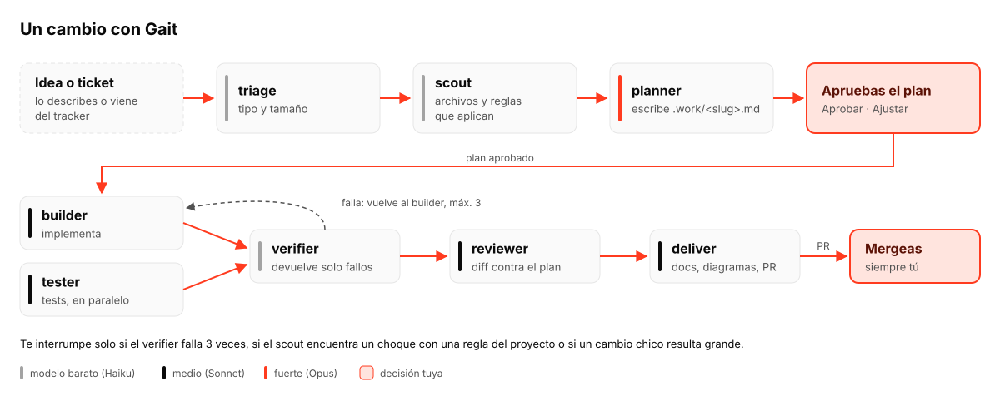
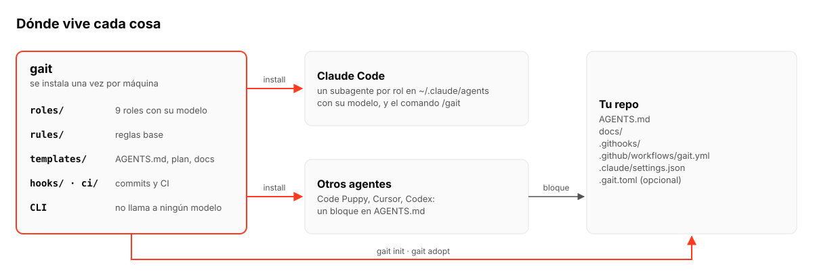
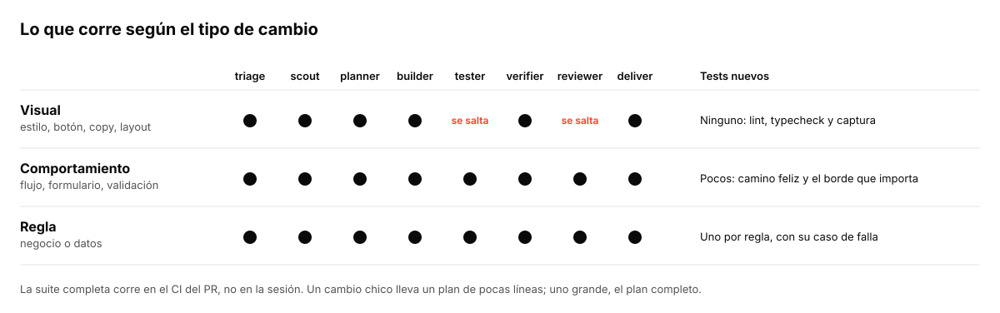
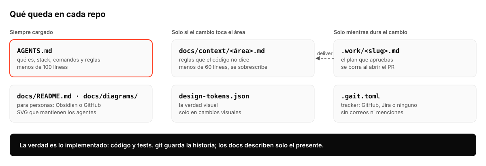

<p align="center">
  <picture>
    <source media="(prefers-color-scheme: dark)" srcset="docs/assets/gait-on-dark.svg">
    
  </picture>
</p>

<p align="center">Estilo de trabajo con agentes de IA, para cualquier proyecto y cualquier agente.</p>

Gait lleva un cambio de la idea o el ticket al PR con el menor contexto posible. Tú apruebas el plan y mergeas; lo demás lo conducen los agentes, cada uno con el modelo que su tarea necesita. Funciona con Claude Code, Code Puppy, Cursor y Codex.



Diseño completo: [docs/plans/2026-10-29-gait-design.md](docs/plans/2026-10-29-gait-design.md).

## Por qué Gait

Los agentes ya escriben buena parte del código, y lo hacen más rápido de lo que un equipo alcanza a revisar. Si cada desarrollador trabaja con su agente a su manera, el equipo ya no sabe qué cambió, por qué ni con qué criterio. Además, el costo de cada cambio varía sin control.

Gait está pensado para empresas y equipos de desarrollo, y escala de una persona a varios equipos. No busca que la IA haga más, sino que el desarrollador y el líder técnico mantengan el control de lo que hace:

- **Visibilidad.** Cada cambio pasa por un plan que una persona aprueba y llega como un PR corto. El PR dice el tipo y el tamaño del cambio, qué mirar primero y cuántas vueltas necesitó. `gait report` muestra por tipo de cambio cuánto tarda, cuántas veces escala y cuántos tokens cuesta.
- **Un flujo estable.** Los mismos pasos, los mismos roles y las mismas validaciones en todos los repos y con cualquier agente. Un proyecto nuevo y uno de hace años se trabajan igual.
- **Decisiones humanas donde importan.** La persona aprueba el plan y mergea. El agente la interrumpe solo cuando algo choca con una regla del proyecto o no logra cerrar el cambio.
- **Costo proporcional.** Un ajuste visual no carga el proceso de una regla de negocio, y el modelo caro se usa solo para planear.

## En qué se diferencia

| | Lo habitual | Gait |
|---|---|---|
| **Especificación** | Metodologías *spec-driven* como Spec Kit, Kiro o BMAD mantienen specs, requisitos y documentos de diseño junto al código. Con el tiempo se desfasan y revisarlos pesa más que el cambio. | El plan vive solo mientras dura el cambio. Lo que sobrevive son el código y los tests; `docs/context/` guarda solo las reglas que el código no dice y se sobrescribe. |
| **Historial de decisiones** | ADRs, deltas y registros de cada decisión, incluidas las que ya no aplican. | Ninguno: la verdad es lo implementado y git guarda la historia. |
| **Proceso** | El mismo para todo cambio, o ninguno. | Proporcional al tipo y tamaño: lo visual no lleva tests ni revisión de modelo; las reglas de negocio llevan un test por regla. |
| **Contexto del agente** | Se carga el repo, los docs y los logs completos en cada sesión. | Contexto en capas: `AGENTS.md` corto siempre, cada ficha de área solo si el cambio la toca. Los roles se pasan resúmenes, nunca logs. |
| **Modelos** | Un solo modelo para todo. | Modelo por rol: barato para lo mecánico, medio para construir y revisar, fuerte solo para planear. |
| **Herramienta** | Atado a un editor o a un agente. | Agnóstico: Claude Code, Code Puppy, Cursor o Codex, con un adaptador por agente. |
| **Cumplimiento** | Depende de que el agente siga las instrucciones. | Lo validan git hooks, CI y `gait check`: formato de commits, sin push a `main`, presupuestos de contexto, rutas y diagramas válidos. |
| **Medición** | Sin datos sobre el costo o el tiempo de cada cambio. | `gait report` por tipo de cambio: tiempo del plan al merge, vueltas, escalamientos y tokens. |

## Instalar

```bash
uv tool install git+https://github.com/XnJaca/gait
gait install          # adaptador del agente detectado (Claude Code u otro)
gait doctor
```

Con otros agentes, `gait install --agent generic` (dentro del repo) agrega el bloque de Gait a `AGENTS.md` y el comando `/gait` en `.agents/commands/gait.md`, que Code Puppy lee.

En Claude Code, `gait install` crea un subagente por rol con su modelo (Haiku para lo mecánico, Sonnet para construir y revisar, Opus solo para planear) y el comando `/gait`. Los modelos se cambian con `--models cheap=haiku,mid=sonnet,strong=opus`.

## Empezar

```bash
gait init             # proyecto nuevo: 3 preguntas y AGENTS.md
gait adopt            # repo existente: rama chore/adopt-gait con la base y el plan de adopción
```



Ambos instalan los git hooks (Conventional Commits, sin firma de herramientas, sin push a `main`), el workflow de CI y los permisos del proyecto para Claude Code.

## Trabajar

Abre el agente y usa `/gait`:

```
¿Qué quieres hacer hoy?
1. Empezar un cambio
2. Continuar lo que dejé
3. Atender revisión de un PR
4. Sesión libre
```

Cada decisión se elige de una lista, no se escribe. En un cambio grande ves un resumen del plan (objetivo, decisiones inferidas, lo difícil de revertir) y abres el archivo solo para ajustarlo.

El proceso pesa según el cambio: un botón no carga lo mismo que una regla de negocio.



## Qué queda en cada repo



```
AGENTS.md            qué es, stack, comandos y reglas (< 100 líneas)
docs/README.md       índice para personas (< 60 líneas)
docs/context/        reglas no obvias por área (< 60 líneas cada una), se sobrescriben
docs/diagrams/       diagramas SVG que mantienen los agentes: overview.svg y flujos o áreas complejas
design-tokens.json   valores visuales, si hay interfaz
.work/<slug>.md      plan del cambio en curso; se borra al abrir el PR
.gait.toml           tracker, si hay
```

Sin specs vivos, ADRs ni historial de decisiones: la verdad es lo implementado y git guarda la historia.

`docs/` se lee mejor en Obsidian (*Open folder as vault* → `docs`), pero todo es markdown y SVG: también se ve en GitHub o en cualquier editor.

## Comandos

| Comando | Qué hace |
|---|---|
| `gait init` / `gait adopt` | Base de un proyecto nuevo / existente |
| `gait install` / `gait doctor` | Adaptador del agente / estado de la instalación |
| `gait start` / `gait continue` | Rama y plan de un cambio / dónde quedó |
| `gait check` | Presupuestos de contexto, rutas rotas, planes en `main` |
| `gait finish` | Quita el plan, hace push y abre el PR con el objetivo, un resumen y las notas de entrega; exige un título Conventional Commit de 72 caracteres o menos |
| `gait tracker` / `gait ticket` | Configura el tracker / lista, muestra y comenta tickets |
| `gait report` | Métricas por tipo de cambio: tiempo, vueltas, escalamientos y tokens (entrada, caché y salida) |

Los comandos los corre el agente. El CLI habla español o inglés según el idioma del sistema (`GAIT_LANG` lo fuerza).

## Tracker

Opcional. `gait tracker set github`, `gait tracker set jira --url https://jira.empresa.com --project KEY` (el token va al llavero con `gait tracker login`), `manual` o `jira-agent` (los tickets los da el agente de la empresa). Correos y menciones nunca llegan al repo.

## CI

`gait init` y `gait adopt` agregan `.github/workflows/gait.yml`. Mientras Gait sea privado, el repo necesita el secret `GAIT_TOKEN` con lectura sobre `XnJaca/gait`.

## Desarrollo

```bash
uv run pytest
```
